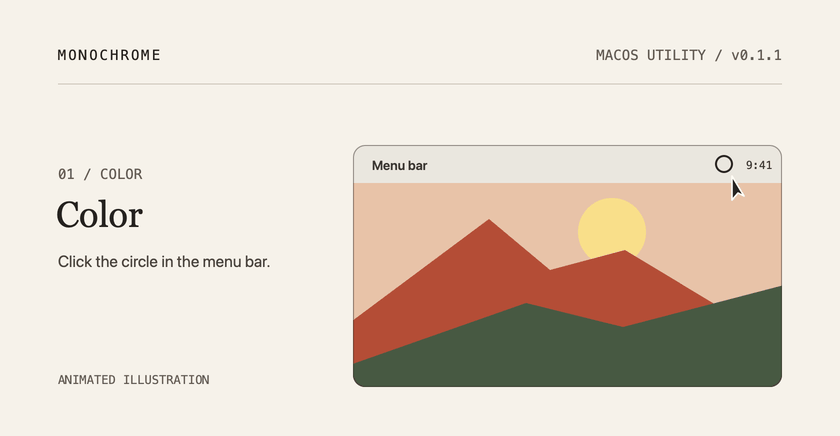

# Monochrome

**Your Mac. Fewer colors. One click.**

A small native macOS menu bar utility that switches the entire display between color and grayscale. No main window. No Dock icon. No Electron.

[Русский](README.ru.md) · [Download alpha](https://github.com/AstralVoid736/Monochrome/releases/tag/v0.1.1-alpha.1) · [Report a bug](https://github.com/AstralVoid736/Monochrome/issues/new/choose)



> **Early alpha.** Uses undocumented macOS APIs. The download is ad-hoc signed, **not notarized by Apple**. Tested on Apple Silicon with macOS 15.6; other systems need validation.

## Download and use

1. Open the [release page](https://github.com/AstralVoid736/Monochrome/releases/tag/v0.1.1-alpha.1) and download **`Monochrome-0.1.1-universal.zip`**, not GitHub's “Source code” archive.
2. Quit version 0.1.0 if it is running. Unzip the download and open `Monochrome.app`.
3. **Left-click the circle in the menu bar** to switch modes. **Right-click** for the menu and Quit.

The app does not change the filter at startup. **Quitting leaves the current system filter in place.** Switch back to color before quitting, or open the app again to switch back.

The experimental GitHub download is not notarized and can fail macOS's Gatekeeper check even when its checksum and ad-hoc signature are valid. Do not disable Gatekeeper. Build locally from source instead if the download is blocked. There is no installer, account, subscription or automatic startup.

## Small by design

- Native **Swift + AppKit**, with no third-party runtime dependencies.
- No network calls, analytics, updater, background helper or polling timer.
- Reads the current system state before toggling and checks the result.
- Refuses to replace another active accessibility color filter.
- Updates its icon after its own actions and when the menu opens. A change made in System Settings can leave the icon stale until then.

Version 0.1.1 prevents a second copy of itself from adding another menu bar icon, even when launched from a different folder. Its interface follows your macOS language preferences for English or Russian.

## Compatibility

| Item | Status |
| --- | --- |
| Apple Silicon / macOS 15.6 | Native filter tests and a two-copy launch test with the 0.1.1 app |
| Intel | Included in the universal binary; not run on physical Intel hardware |
| Minimum bundle target | macOS 13.0; not a promise that every later release works |
| Sleep/wake, multiple displays | Not separately validated |
| Ordinary right-click and menu Quit | Implemented; AppKit target/actions tested, separate physical-input acceptance pending |
| Apple notarization | Not available in this alpha |
| Windows / Linux | Not implemented |

Undocumented APIs may change or disappear. Missing libraries or symbols produce an error, not a success message. See [implementation notes](docs/IMPLEMENTATION.md).

## Build

Requires existing Apple Command Line Tools with Swift and the macOS SDK. The local build was exercised with **Swift 6.1.2**. No package downloads are performed by these scripts.

```bash
git clone https://github.com/AstralVoid736/Monochrome.git
cd Monochrome
bash scripts/build.sh             # current architecture
# or: bash scripts/build.sh --universal
open dist/Monochrome.app
```

The output is `dist/Monochrome.app`, locally ad-hoc signed. Building does not install or launch it automatically.

## Test

```bash
bash scripts/test.sh              # single-instance, controller and AppKit checks
```

The standard tests do **not** change the real display filter. CI runs these checks and a universal build. A successful CI build is not physical display validation.

Optional manual integration test, **only when a brief real display change is acceptable**:

```bash
bash scripts/test.sh --native
```

It snapshots the system filter, toggles both ways and restores the snapshot on normal completion. Do not force-kill it: cleanup cannot survive a crash or `SIGKILL`. It refuses to proceed when another color filter is active. System preference readback is not itself proof of the physical display image.

## Project

- [Contributing](CONTRIBUTING.md) · [Security](SECURITY.md) · [Privacy](PRIVACY.md)
- [Changelog](CHANGELOG.md) · [Release checklist](docs/RELEASING.md)
- [MIT license](LICENSE) · [Acknowledgements](ADAPTATION.md)

Ideas and bug reports are welcome. Please include your macOS version and processor type, and keep personal data out of reports.
