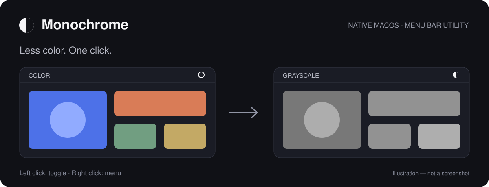

# Monochrome

**Меньше цвета. Один клик.**

Небольшая нативная утилита macOS: переключает весь экран между цветным режимом и оттенками серого. Работает через значок в строке меню — без основного окна и значка в Dock.

[English](README.md) · [Скачать alpha](https://github.com/AstralVoid736/Monochrome/releases/tag/v0.1.0-alpha.1) · [Сообщить об ошибке](https://github.com/AstralVoid736/Monochrome/issues/new/choose)



> **Ранняя alpha.** Использует недокументированные API macOS. Сборка подписана локальной ad-hoc подписью, **без нотариализации Apple**. Проверена на Apple Silicon с macOS 15.6; другие системы требуют проверки.

## Скачать и запустить

1. На [странице релиза](https://github.com/AstralVoid736/Monochrome/releases/tag/v0.1.0-alpha.1) скачай **`Monochrome-0.1.0-universal.zip`**, а не архив «Source code».
2. Распакуй его и открой `Monochrome.app`. Для постоянного использования можно перенести приложение в «Программы».
3. **Левый клик по кружку в строке меню** переключает режим. **Правый клик** открывает меню с выходом.

При запуске приложение не меняет фильтр. **Выход оставляет текущий системный фильтр включённым.** Чтобы вернуть цвета, переключи режим до выхода или снова открой приложение.

Если macOS блокирует экспериментальную сборку, не отключай Gatekeeper целиком. Альтернатива — собрать приложение из исходников. Установщик, аккаунт и подписка не нужны; автозапуск не включается.

## Без лишнего

- **Swift + AppKit**, без Electron и сторонних runtime-зависимостей.
- Без сетевых запросов, аналитики, автообновления, фонового помощника и периодического опроса.
- Перед переключением читает состояние macOS, после — проверяет результат.
- Не заменяет другой уже включённый цветовой фильтр универсального доступа.
- Значок обновляется после собственного переключения и при открытии меню. После изменения через настройки macOS он может временно показывать старое состояние.

Интерфейс приложения сейчас на русском. Оттенки серого — настройка изображения, а не доказанный способ повысить продуктивность.

## Совместимость

| Что | Статус |
| --- | --- |
| Apple Silicon / macOS 15.6 | Пройдены локальные native-тесты, AXPress настоящего значка; пользователь подтвердил работу |
| Intel | Включён в universal binary; на настоящем Intel не запускался |
| Минимальная цель сборки | macOS 13.0; работа на каждой более новой версии не гарантирована |
| Сон/пробуждение, несколько дисплеев | Отдельно не проверены |
| Обычный правый клик и выход через меню | Реализованы; программные target/actions AppKit проверены, физический ввод отдельно не принят |
| Нотариализация Apple | В этой alpha отсутствует |
| Windows / Linux | Не реализованы |

Недокументированные API могут измениться или исчезнуть. Если библиотека или символ недоступны, приложение покажет ошибку, а не успех. Подробнее — в [технических заметках](docs/IMPLEMENTATION.md).

## Сборка

Нужны уже установленные Apple Command Line Tools со Swift и macOS SDK. Локальная сборка проверена со **Swift 6.1.2**. Скрипты ничего не устанавливают и не загружают.

```bash
git clone https://github.com/AstralVoid736/Monochrome.git
cd Monochrome
bash scripts/build.sh             # текущая архитектура
# или: bash scripts/build.sh --universal
open dist/Monochrome.app
```

Результат — `dist/Monochrome.app` с локальной ad-hoc подписью. Сборка сама не устанавливает и не запускает приложение.

## Проверки

```bash
bash scripts/test.sh              # логика + программные действия AppKit-контролов
```

Обычные тесты **не меняют настоящий фильтр экрана**. GitHub Actions запускает эти проверки и universal-сборку. Успешный CI не доказывает физическое изменение изображения.

Дополнительный интеграционный тест — **только когда допустимо краткое изменение настоящего экрана**:

```bash
bash scripts/test.sh --native
```

Тест сохраняет исходную конфигурацию, переключает режим в обе стороны и восстанавливает её при штатном завершении. Не завершай его принудительно: восстановление не защищает от аварии процесса или `SIGKILL`. При активном другом цветофильтре тест отказывается от изменений. Чтение системной настройки само по себе не доказывает вид физического дисплея.

## Проект

[Участие](CONTRIBUTING.md) · [Безопасность](SECURITY.md) · [Приватность](PRIVACY.md) · [Изменения](CHANGELOG.md) · [Лицензия MIT](LICENSE)

В сообщении об ошибке укажи версию macOS и тип процессора. Не добавляй личные данные, ключи и снимки приватных окон.
